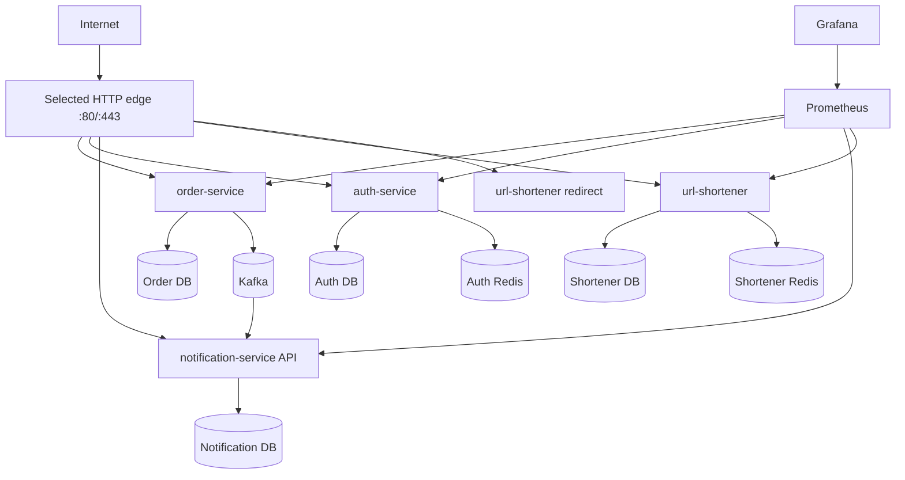

# Infrastructure architecture

## First production-like target

A single Selectel VPS running Docker Compose is intentionally the first target. It is large enough to
demonstrate deployment, networking, observability and recovery while remaining understandable and
operable by one developer.

Components shown are target responsibilities. They are added only when the corresponding service is
implemented.

## Network zones

### Public edge

Only the selected Caddy or Nginx edge exposes host ports 80/443. Public DNS maps service hostnames to the VPS when that service is
ready.

### Application network

Service containers communicate by Docker DNS/service name. Internal application ports are not
published to the host unless a temporary, documented diagnostic need exists.

### Data network

PostgreSQL/Redis/Kafka are reachable only by authorized application/ops containers. Admin tools such as
Kafka UI or Mailpit are local/integration conveniences and should not be internet-facing in production.

## Edge host mapping

Initial mapping follows the frontend's existing runtime configuration:

- `order-api.zolotoy.dev` → Order HTTP API;
- `auth-api.zolotoy.dev` → Auth HTTP API;
- `notification-api.zolotoy.dev` → Notification read/admin API;
- `shortener-api.zolotoy.dev` → Shortener management API;
- `s.zolotoy.dev` → public short-link redirect path.

The chosen edge must terminate HTTPS and implement certificate renewal according to its validated
configuration. Do not publish DNS before the upstream service passes readiness checks.

## Storage ownership

A service owns its schema and migrations. No infrastructure migration may create cross-service foreign
keys or joins. A single physical PostgreSQL process may be considered later for VPS efficiency only if
logical DB/user isolation and backup/restore boundaries are preserved; that choice requires an ADR based
on resource measurements.

Redis is similarly service-owned. Kafka is shared transport; topic naming/schema/versioning are owned by
producers/consumers, not hidden in Compose alone.
